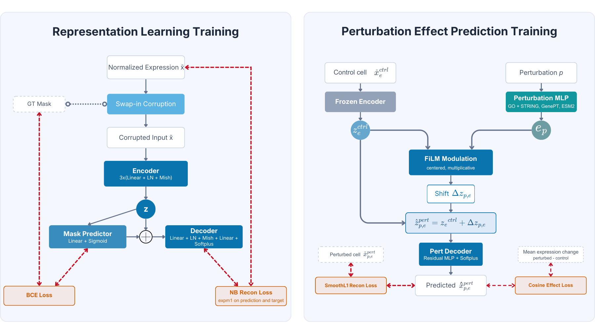

# Occam

**Cell representation learning and perturbation-effect prediction with multilayer perceptrons.**
Occam learns from gene expression and combines gene-interaction, text, and protein-sequence
information to predict how a genetic perturbation changes a control cell.

[Paper](https://arxiv.org/abs/2611.21959) ·
[Models and data](https://huggingface.co/bendidiihab/Occam) ·
[Benchmark results](data/release/official_comparisons/official_tables.md)

[](docs/assets/architecture.pdf)

## Install

The training environment uses **Python 3.8** and PyTorch 2.4.1. Use a CUDA GPU for training;
small inference jobs can run on CPU.

```bash
git clone https://github.com/IhabBendidi/Occam.git
cd Occam
python3.8 -m venv .venv
source .venv/bin/activate
pip install -e ".[hub,graph]"
```

## Choose your download

Each command downloads only the requested files and puts them where the code expects them.
Add `--dry-run` to list the files without downloading anything.

| What you need | Command | Guide |
|---|---|---|
| **Encoder–decoder:** embed cells, reconstruct expression, or initialize a new virtual-cell model | `python scripts/download_release.py encoder-decoder` | [Encoder–decoder](docs/downloads.md#encoderdecoder) |
| **Virtual-cell model:** predict perturbation effects directly | `python scripts/download_release.py virtual-cell --benchmark rhj --seed 42` | [Virtual-cell models](docs/downloads.md#virtual-cell-models) |
| **Benchmark data:** train or evaluate on the paper's datasets | `python scripts/download_release.py data --benchmark rhj` | [Data](docs/downloads.md#data) |

Use `--benchmark norman` for the double-perturbation model or its dataset.
Virtual-cell checkpoints already include their encoder and decoder; they do **not** require
an additional encoder–decoder download. Seeds 42–46 are available.
[Competitor checkpoints](https://huggingface.co/bendidiihab/Occam-competitor-checkpoints)
are hosted separately.

## Use a model

Embed cells with the encoder–decoder:

```python
import anndata as ad
from occam.api import load_encoder

cells = ad.read_h5ad("my_cells.h5ad")
encoder = load_encoder("checkpoints/release/occam_small_encoder_decoder.pth")
embeddings = encoder.encode(cells, gene_col="gene_id")
```

Predict perturbation effects with a virtual-cell checkpoint:

```python
from occam.api import load_virtual_cell

controls = ad.read_h5ad("my_controls.h5ad")
model = load_virtual_cell("checkpoints/vcell/rhj/seed_42/best_model.pth")
predictions = model.predict(controls, ["FOXA1"], gene_col="gene_id")
predictions.write_h5ad("predictions.h5ad")
```

Inputs should contain raw counts in `.X`. `gene_id` is a `.var` column of gene identifiers;
use Ensembl IDs with the released models. Omit `gene_col` if the IDs are in `.var_names`.
[API reference](docs/api.md) covers reconstruction, predicted deltas, and double perturbations.

## Train on your own data

Run the complete representation-training sequence with one command:

```bash
python scripts/train_representation.py \
    --data my_cells.h5ad --gene-col gene_id --output runs/my_encoder
```

This trains the encoder and its expression decoder, passing checkpoints between stages
automatically. It requires no perturbation labels or downloaded benchmark data.

To train on a **folder of AnnData files**, including subfolders, use:

```bash
python scripts/train_representation.py \
    --data my_datasets/ --data-mode optim --gene-col gene_id --output runs/my_encoder
```

Folder mode reads `.h5ad` files in chunks without merging them first. It currently requires
dense `.X` matrices; see the [folder guide](docs/training.md#train-on-a-folder-of-anndata-files) for gene alignment.

- [Train an encoder–decoder](docs/training.md): data format, validation, settings, and a CPU smoke test.
- [Train a virtual-cell model](docs/virtual-cell-training.md): control and perturbation data, initialization, and splits.
- [Reproduce the paper's evaluations](docs/benchmarking.md): released checkpoints, datasets, and scoring commands.

## Cite us

If you use Occam, please cite our [paper](https://arxiv.org/abs/2611.21959)
([DOI](https://doi.org/10.48550/arXiv.2611.21959)):

```bibtex
@misc{bendidi2026occam,
  title        = {{OCCAM}: Improved Single-Cell Representation Learning and Perturbation Effect Prediction},
  author       = {Bendidi, Ihab and Kenyon-Dean, Kian and Denton, Alisandra K. and Genovesio, Auguste and Noutahi, Emmanuel},
  year         = {2026},
  eprint       = {2611.21959},
  archivePrefix = {arXiv},
  primaryClass = {q-bio.QM},
  doi          = {10.48550/arXiv.2611.21959},
  url          = {https://arxiv.org/abs/2611.21959}
}
```
